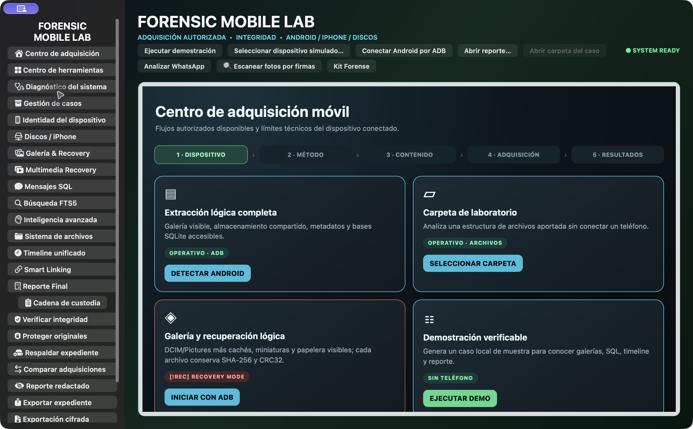
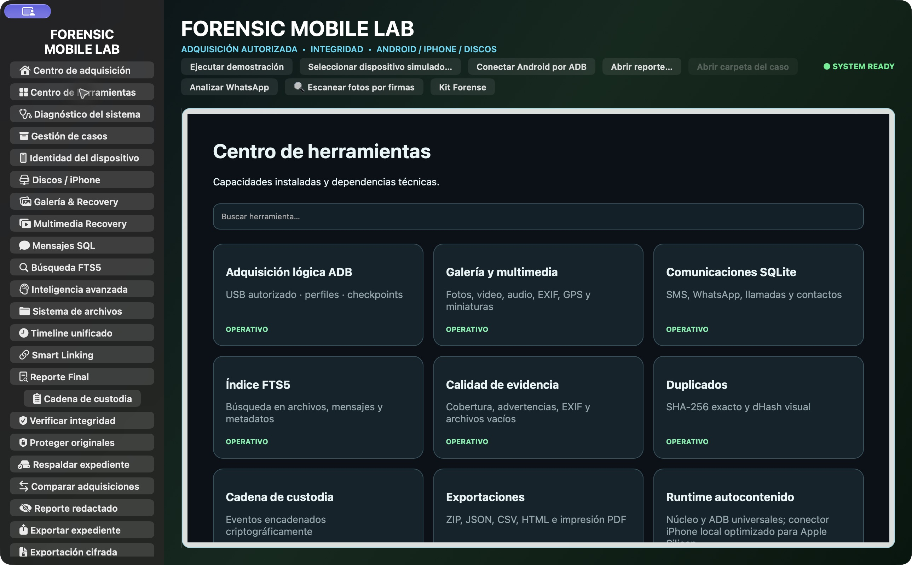
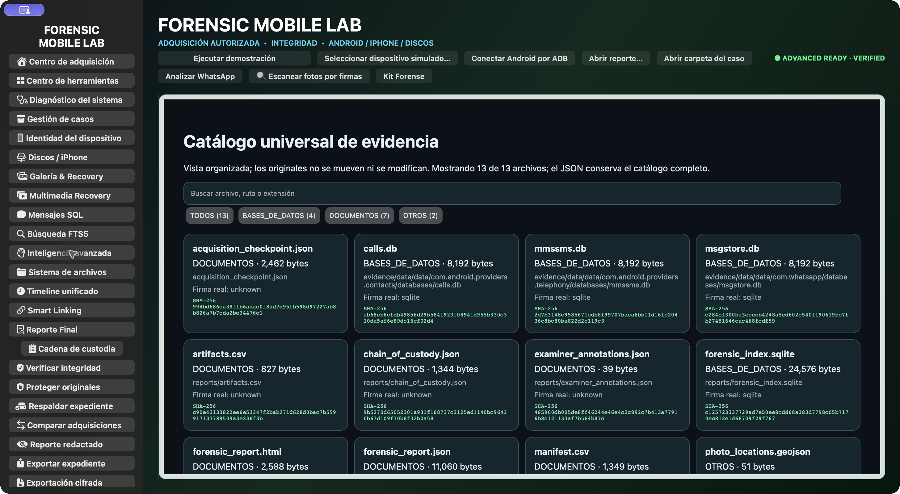

# Capturas de Forensic Mobile Lab

Capturas reales de la aplicación 3.2.0 en macOS. Las pantallas de inicio y herramientas no tienen un expediente cargado; el catálogo muestra únicamente el expediente sintético generado por **Ejecutar demostración**. No se muestran casos reales ni dispositivos conectados.

## Centro de adquisición

## Centro de herramientas

## Catálogo del expediente de demostración

